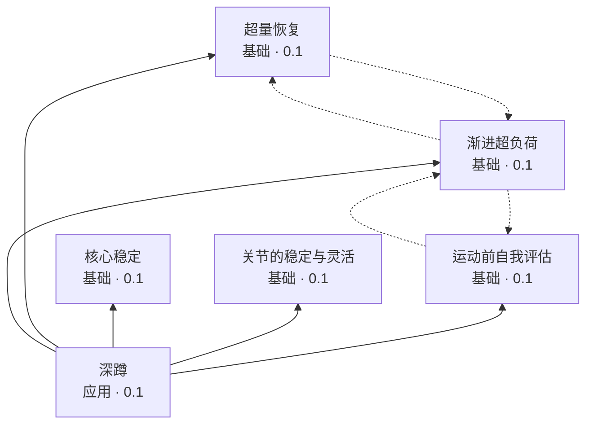

<!-- 由 tools/kgraph.py 自动生成,勿手改 -->
# 知识图谱与可信度(试运行规则 v0)

自身可信度:模型生成未核验 0.1,人工撰写未核验 0.2,每多一位独立的人对当前版本核验通过 +0.2,上限 0.9。
有效可信度:自身可信度与所依据单元的有效可信度取最小。**一条知识不可能比它的地基更可信。**

## 图

实线为"依据"(传递可信度),虚线为"参见"。节点内为有效可信度。

## 单元一览

| 单元 | 层级 | 来源 | 当前版本 | 核验通过人数 | 自身可信度 | 有效可信度 | 被谁卡住 |
|---|---|---|---|---|---|---|---|
| [核心稳定](base-core-stability.md) | 基础 | 模型生成(Claude Opus 5.5) | v1 | 0 | 0.1 | **0.1** | —(取决于自身) |
| [关节的稳定与灵活](base-joint-stability-mobility.md) | 基础 | 模型生成(Claude Opus 5.5) | v1 | 0 | 0.1 | **0.1** | —(取决于自身) |
| [运动前自我评估](base-preparticipation-screening.md) | 基础 | 模型生成(Claude Opus 5.5) | v1 | 0 | 0.1 | **0.1** | —(取决于自身) |
| [渐进超负荷](base-progressive-overload.md) | 基础 | 模型生成(Claude Opus 5.5) | v1 | 0 | 0.1 | **0.1** | —(取决于自身) |
| [超量恢复](base-supercompensation.md) | 基础 | 模型生成(Claude Opus 5.5) | v1 | 0 | 0.1 | **0.1** | —(取决于自身) |
| [深蹲](app-squat.md) | 应用 | 模型生成(Claude Opus 5.5) | v1 | 0 | 0.1 | **0.1** | —(取决于自身) |

## 优先核验顺序

按"有多少单元直接或间接依据它"排序。越靠前,核验它能抬高的下游单元越多。

| 顺序 | 单元 | 层级 | 依据它的下游单元数 | 当前自身可信度 |
|---|---|---|---|---|
| 1 | 核心稳定 | 基础 | 1 | 0.1 |
| 2 | 关节的稳定与灵活 | 基础 | 1 | 0.1 |
| 3 | 运动前自我评估 | 基础 | 1 | 0.1 |
| 4 | 渐进超负荷 | 基础 | 1 | 0.1 |
| 5 | 超量恢复 | 基础 | 1 | 0.1 |
| 6 | 深蹲 | 应用 | 0 | 0.1 |

## 完整性检查

- 无问题:引用目标齐全,"依据"无环,引用版本均为最新。
